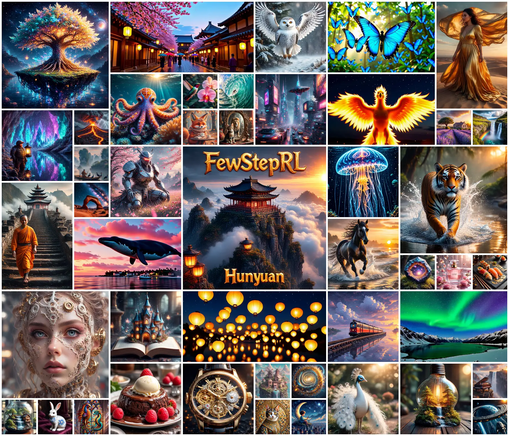
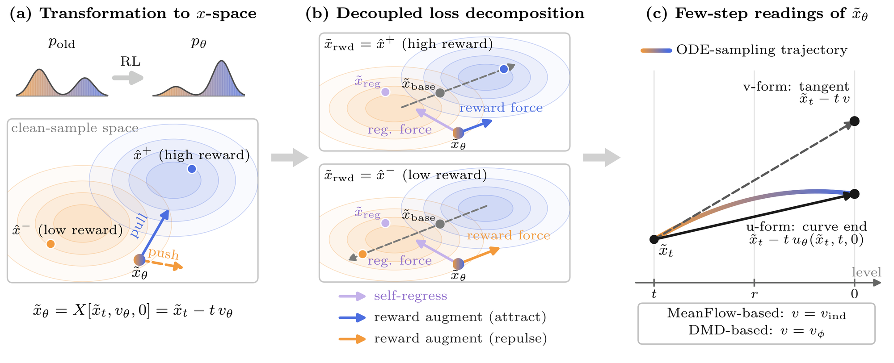
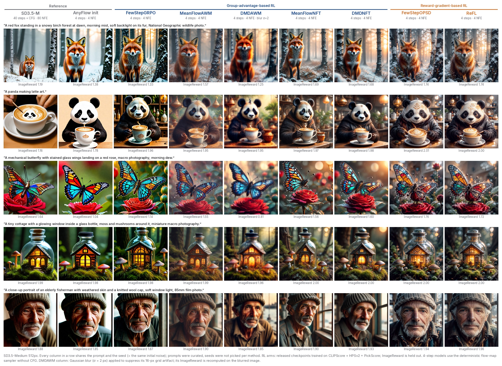
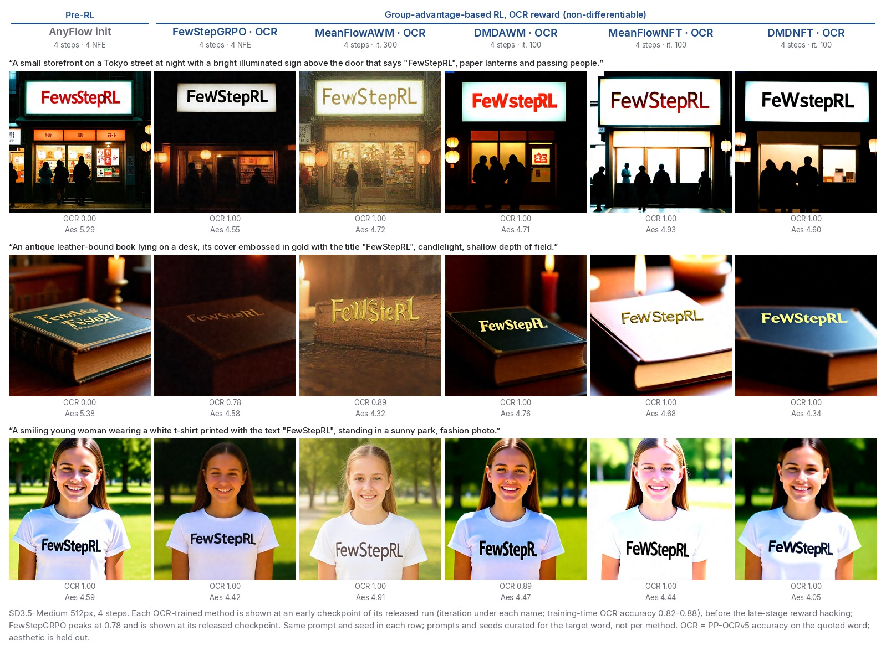

<div align="center">

# FewStepRL <sub><sup>— Hunyuan</sup></sub>

### Fine-tuning Few-step Diffusion Models with Reinforcement Learning

Haitao Lin<sup>1,\*,†</sup>, Minsi Ren<sup>2,\*</sup>, Yang Li<sup>1,†</sup>, Xingtong Ge<sup>1</sup>, Zheyuan Hu<sup>1</sup>, Peiyan Hu<sup>2,3</sup>, Tailin Wu<sup>2,‡</sup>

<sup>1</sup>Tencent Hunyuan · <sup>2</sup>Westlake University · <sup>3</sup>University of Chinese Academy of Sciences

<sub><sup>\*</sup>Equal contribution · <sup>†</sup>Project leader · <sup>‡</sup>Corresponding author: wutailin@westlake.edu.cn</sub>

[](https://arxiv.org/abs/2611.08240) [](https://edapinenut.github.io/fewsteprl.page/) [](https://huggingface.co/Delcher/fewsteprl-sd35)

**Image (SD3.5-Medium) code** · video code: [fewsteprl-wan21](https://github.com/EDAPINENUT/fewsteprl-wan21) · checkpoints: [🤗 Delcher/fewsteprl-sd35](https://huggingface.co/Delcher/fewsteprl-sd35)

<a href="assets/gallery.mp4"></a>

<sub>Every tile is generated in <b>4 sampling steps without CFG</b> by a released FewStepRL checkpoint: SD3.5-Medium images (512²) and,
in the moving tiles, Wan2.1 videos (480×832). The text of the centre poster — “FewStepRL” and the small “Hunyuan” — is rendered by the model itself (DMDNFT).
Trainer, prompt, seed and a one-line reproduction command for every tile: <a href="assets/gallery_index.md">gallery index</a>
(<a href="assets/gallery.jpg">still image</a>).</sub>

</div>

🔥 **FewStepRL** adapts reinforcement-learning objectives to few-step (flow-map) generators in three phases —
a **transformation** to *x*-space, a **decomposition** of the gradient, and an **adaptation** of its anchors to an
average-velocity model — which yields few-step versions of **FlowGRPO, AWM, DiffusionNFT, DiffusionOPSD and ReFL**
in one modular codebase.

## ✨ Method in three phases

<p align="center"></p>

- 🧭 **Transformation to *x*-space.** Under the linear noise schedule a velocity transports a state affinely, so each objective is expressed through a common policy prediction, by default the clean end $\tilde x_\theta=\tilde x_t-t\,v_\theta$ (transition and flow-map objectives use an explicitly marked level); objectives stated over densities, velocities or rewards become comparable.
- 🧩 **Decoupled decomposition.** The gradient of each objective is a reward-free **self-regression** toward an anchor $\tilde x_{\mathrm{reg}}$ plus a **reward augmentation** along $\tilde x_{\mathrm{rwd}}-\tilde x_{\mathrm{base}}$: a method is a choice of three anchors and three weights, not a new loss.
- ⚡ **Few-step adaptation.** The anchors are computed from a few-step model at the end of its transport (u-form) or along its tangent (v-form), with the instantaneous velocity recovered from the network itself through the MeanFlow identity (`v-ind`) or from an auxiliary network as in DMD (`v-aux`).

**Findings.** Where the reward is differentiable and its gradient affordable, the reward-gradient trainers (FewStepOPSD, ReFL) are the most effective;
otherwise the DiffusionNFT family reaches high rewards in relatively few iterations. More sampling steps than in training bring no systematic aggregate gain.

## 🖼️ Same prompt, same noise, nine models

<p align="center"></p>

All RL columns start from the same 4-step AnyFlow checkpoint and are trained on CLIPScore + HPSv2 + PickScore (ImageReward under each image is held out).
**Group-advantage-based RL** (FewStepGRPO, MeanFlowAWM, DMDAWM, MeanFlowNFT, DMDNFT) uses only reward values of grouped rollouts;
**reward-gradient-based RL** (FewStepOPSD, ReFL) back-propagates through the differentiable reward.
As in Tab. 6(b) of the paper, the reward-gradient trainers reach the highest training reward and the only CLIPScore gain in the default mixed-reward configuration, the NFT family comes next,
and FewStepGRPO moves least from the initialization. In the paper's test-time-scaling study, SD3.5-Medium even with 32 steps + CFG stays below every fine-tuned 4-step model on HPSv3, ImageReward, aesthetic score, HPSv2 and PickScore (§6.5).
DMDAWM samples carry a faint periodic pattern on the 16-pixel latent-patch lattice; its column is shown after a Gaussian blur (σ = 2 px),
and its ImageReward values are recomputed on the blurred images. All other images are unprocessed.

## 🔤 A non-differentiable reward: rendering “FewStepRL”

<p align="center"></p>

With OCR accuracy as the only reward (no gradient, so FewStepOPSD and ReFL do not apply), the trainers learn to spell the target word,
but the OCR gains come with held-out degradation (reward hacking) that grows with training: at the first checkpoint with OCR accuracy above 0.82,
held-out HPSv3 falls from 12.86 (AnyFlow) to 10.64 (MeanFlowNFT, it. 100), 7.58 (DMDNFT, it. 100) and 5.05 (DMDAWM, it. 200) (paper Tab. 6(a)).
The figure therefore shows each run at an **early iteration** with OCR accuracy 0.82–0.88 (DMDAWM it. 100: 0.820, DMDNFT it. 100: 0.829,
MeanFlowNFT it. 100: 0.850, MeanFlowAWM it. 300: 0.876 from its training log, beyond the paper's 200-iteration horizon);
FewStepGRPO never exceeds 0.78 and is shown at its released checkpoint (it. 200, 0.776). The early-iteration checkpoints are intermediate
checkpoints of the released runs and are not part of `checkpoints/`.

## 📦 This repository

Reinforcement learning for a **few-step (4-step) SD3.5-Medium flow-map
generator**. Every experiment starts from the same model -- SD3.5-Medium with
the AnyFlow Stage-1 (flow-map pretraining) and Stage-2 (on-policy distillation)
LoRAs merged in -- and trains a Stage-3 LoRA with one RL algorithm on one of
two reward settings:

- **mix**: train on clipscore + hpsv2 + pickscore (`dataset/pickscore` prompts);
  evaluated on aesthetic / clipscore / hpsv2 / pickscore (drawbench) plus ocr as
  a held-out metric.
- **ocr**: train on PaddleOCR text accuracy (`dataset/ocr` prompts); evaluated
  on aesthetic / clipscore / ocr.

## Experiments

Each name is simultaneously the launcher `scripts/train/<name>.sh`, the config
`scripts/train/configs/<name>.yaml`, and the released checkpoint
`checkpoints/<name>/` (see [checkpoints/README.md](checkpoints/README.md) for
steps and archived scores).

| family | mix | ocr | trainer key | module |
|---|---|---|---|---|
| MeanFlowNFT | `meanflownft_mix` | `meanflownft_ocr` | `meanflow_nft` | `fewsteprl/trainers/meanflownft.py` |
| NFT (S-term ablation) | `nft_mix` | -- | `nft_rl` | `fewsteprl/trainers/meanflownft.py` |
| DMD-NFT (aux v-predictor anchor) | `dmdnft_mix` | `dmdnft_ocr` | `dmdnft_rl` | `fewsteprl/trainers/dmdnft.py` |
| DMD-AWM (no central difference) | `dmdawm_mix` | `dmdawm_ocr` | `dmdawm_rl` | `fewsteprl/trainers/dmdawm.py` |
| MeanFlowGRPO | `fewstepgrpo_mix` | `fewstepgrpo_ocr` | `meanflowgrpo_rl` | `fewsteprl/trainers/meanflowgrpo.py` |
| FlowGRPO (S-term ablation) | `flowgrpo_mix` | -- | `flowgrpo_rl` | `fewsteprl/trainers/meanflowgrpo.py` |
| MeanFlowAWM | `meanflowawm_mix` | `meanflowawm_ocr` | `meanflowawm_rl` | `fewsteprl/trainers/meanflowawm.py` |
| AWM (S-term ablation) | `awm_mix` | -- | `awm_rl` | `fewsteprl/trainers/meanflowawm.py` |
| MeanFlow-OPSD | `meanflowopsd_mix` | -- | `meanflowopsd_rl` | `fewsteprl/trainers/meanflowopsd.py` |
| ReFL special case of OPSD | `reflmx_mix` | -- | `meanflowrefl_rl` | `fewsteprl/trainers/meanflowrefl.py` |

OPSD and ReFL have no OCR experiment: they need a differentiable reward, and OCR
accuracy has no gradient with respect to the image. All trainers share
`fewsteprl/trainers/rl_general_base.py` (rollout, advantages, decoupled loss,
eval) on top of `fewsteprl/trainers/base_trainer.py`.

## Layout

```
main.py                  training entry point (TRAINER_REGISTRY)
inference.py             sampling entry point (used by scripts/eval)
fewsteprl/               library: config, SD3.5 flow-map model, trainers, reward scorers
dataset/                 prompt sets: pickscore, ocr (train/test); drawbench, hpsv3, geneval2 (test)
scripts/train/           <name>.sh launchers, shared _launcher_*.sh, configs/<name>.yaml
scripts/eval/            sampling + reward scoring (see scripts/eval/README.md)
checkpoints/             configs of the released runs (weights on Hugging Face)
download_scripts/        download_assets.sh: SD3.5, Stage-1/2 LoRAs, reward models
models/                  (created by download_assets.sh, not tracked)
```

## Setup

```bash
pip install -r requirements.txt          # Python 3.10, CUDA 12.4, torch 2.6
bash download_scripts/download_assets.sh # needs internet + an accepted SD3.5-M license
hf download Delcher/fewsteprl-sd35 --local-dir checkpoints --include "*.pt" "*.safetensors"   # released checkpoints
```

`download_assets.sh` places everything under `models/`; the launchers check for
each file before spawning ranks and print the fix if one is missing. Every
location can be overridden with `FEWSTEPRL_SD35_PATH`,
`FEWSTEPRL_REWARD_CKPT_PATH`, `FEWSTEPRL_PADDLEOCR_V5_DIR`, `HF_HOME`. Training
runs fully offline (`HF_HUB_OFFLINE=1`, `WANDB_MODE=offline` by default; export
`WANDB_MODE=online` to log to wandb).

## Training

```bash
bash scripts/train/<name>.sh [NUM_GPUS] [OVERRIDES...]

bash scripts/train/meanflownft_mix.sh 8
bash scripts/train/dmdawm_ocr.sh 8 fewstep_rl.num_epochs=10      # short 10-step test run
NNODES=2 NODE_RANK=0 MASTER_ADDR=<host> bash scripts/train/reflmx_mix.sh 8
```

Overrides are `key=value` on the config (`train.seed=1`,
`eval.eval_interval=25`, ...). The configs keep `fewstep_rl.num_epochs: 10000`
and runs are stopped by hand; the released checkpoints are at step 200-400
(see `checkpoints/README.md`). `train.batch_size * total_gpus` must be
divisible by `fewstep_rl.num_image_per_prompt` (24), which the launcher checks;
the configs assume 8 GPUs (batch 9 x 8 = 72 = 3 prompts x 24 images).

The `dmd*` experiments warm-start their auxiliary v-predictor from
`checkpoints/aux_vel/{mix,ocr}` (`model.aux_v_init_path`); those weights are
not in git (~9.9 GB each, see `checkpoints/README.md`). Outputs go to
`outputs/<name>/<timestamp>/checkpoint-<step>/`; `generator_ema.pt` there is
what `scripts/eval` consumes.

## Evaluation

```bash
bash scripts/eval/eval_ckpt.sh meanflownft_mix 8   # one checkpoint
bash scripts/eval/eval_all.sh 8                    # base + all checkpoints -> outputs/eval/summary.md
```

Environment, scorer download links, protocol and caveats:
[scripts/eval/README.md](scripts/eval/README.md).

## Citation

```bibtex
@article{lin2026fewsteprl,
  title   = {FewStepRL: Fine-tuning Few-step Diffusion Models with Reinforcement Learning},
  author  = {Lin, Haitao and Ren, Minsi and Li, Yang and Ge, Xingtong and
             Hu, Zheyuan and Hu, Peiyan and Wu, Tailin},
  journal = {arXiv preprint arXiv:2611.08240},
  year    = {2026}
}
```

## License

See [LICENSE](LICENSE). SD3.5-Medium and the reward models are under their own
licenses.
